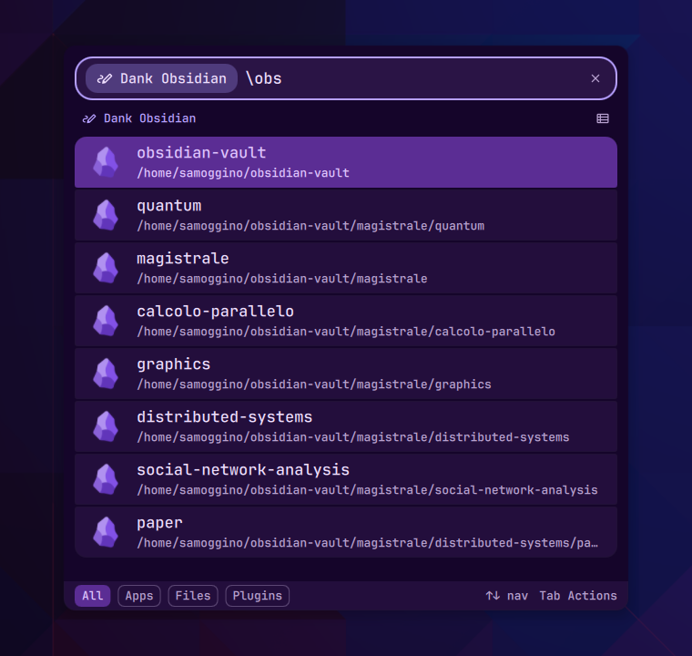

# Obsidian Launcher for DuxShell (formerly DankMaterialShell)

A launcher plugin for [DuxShell](https://duxlabs.dev/) (formerly [DankMaterialShell](https://github.com/AvengeMedia/DankMaterialShell)) that lets you quickly open your Obsidian vaults.



## Features

* **Quick Search**: Find your vaults by name.
* **Live Vault List**: Vaults added to or removed from Obsidian show up in the launcher right away, with no shell reload needed.
* **Hide Vaults**: Hide a vault from the launcher's context menu (right click or menu key → *Hide vault*), or with the per-vault toggles in the settings.
* **Custom Icons**: Give each vault its own icon: a Material Symbols icon picked from the built-in icon picker, an emoji, or any icon from your icon theme.
* **Open Folder**: Open a vault's folder in your file manager from the launcher's context menu.
* **Flatpak Support**: Works with both native and Flatpak Obsidian installations.
* **Always Active Mode**: Show vaults directly in the launcher without a trigger.
* **Custom Trigger**: Define your own keyword (e.g., `\obs`, `ob`) to filter results.

## Usage

### In the launcher

Type the trigger (default `\obs`) followed by part of the vault name, then press Enter to open it.
Right click a vault (or press the menu key) to open its context menu:

| Action | What it does |
|---|---|
| **Hide vault** | Removes the vault from the launcher. Bring it back from the settings. |
| **Open folder** | Opens the vault folder with `xdg-open`. |

### In the settings

Open the plugin settings in the shell and scroll to the **Vaults** section. It lists every vault found in `obsidian.json`:

* Use the **toggle** to show or hide a vault in the launcher.
* Click the **vault icon** (the one with the pencil) to edit it:
  * **Choose icon**: pick a Material Symbols icon from a searchable list.
  * **Text field**: paste an emoji (e.g. `📓`) or type an icon-theme name (e.g. `folder-documents`).
  * **↺** resets to the Obsidian icon, **✓** (or Enter) applies the change.

Accepted icon formats, if you prefer to type them:

| Format | Example |
|---|---|
| `material:<name>` | `material:school` |
| `unicode:<character>` (or just the emoji) | `unicode:📓` |
| icon-theme name | `obsidian`, `folder-documents` |

All changes apply to the launcher immediately.

## Installation

1. Make sure **DuxShell** (or DankMaterialShell) is installed and working.
2. The easiest way to install is through the plugin registry.
3. Alternatively, clone this repository into your plugins folder:
    ```bash
    cd ~/.config/dms/plugins/
    git clone https://github.com/Samoggino/dankObsidian
    ```

## Requirements

* **DuxShell / DankMaterialShell** with launcher plugin support.
* **Obsidian**: installed via Flatpak or natively (opened through `xdg-open`).
* For emoji icons: a color emoji font (e.g. Noto Color Emoji).

## How I Developed It

I developed this plugin using LLMs like **Gemini** and **Qwen**, because I had no prior experience with *QML*. Version 2 was developed with **Claude Code**.
I designed this plugin with portability in mind:

* It is compatible with both **native** and **Flatpak** versions of Obsidian (I tested both).
* The code has been tested exclusively on CachyOS with Hyprland, but it should work on any Linux distribution that supports Flatpak or `xdg-open`, and any compositor that supports Quickshell.

## Changelog

### 2.0.0

* Hide vaults from the launcher context menu or from the settings.
* Per-vault custom icons (Material Symbols picker, emoji, icon-theme names).
* "Open folder" action in the launcher context menu.
* The vault list updates live when `obsidian.json` changes; settings changes apply to the launcher without a reload.
* Fixed the default trigger (`\obs`).

### 1.0.1

* Initial public release.

## Credits & License

* Inspired by the [DMS VSCode Launcher](https://github.com/sr-tream/dms-vscode-launcher) logic.
* This project is licensed under the **MIT License** - see the [LICENSE](LICENSE) file for details.

Developed with ❤️ by Samoggino on CachyOS, I hope this plugin to be useful for the Obsidian community and DuxShell users.
